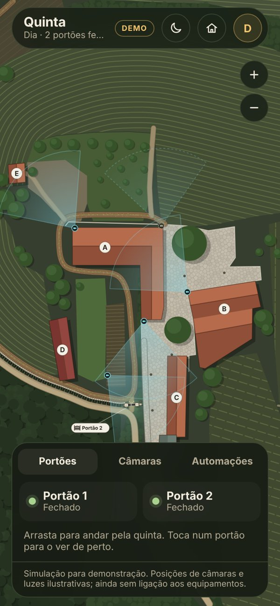
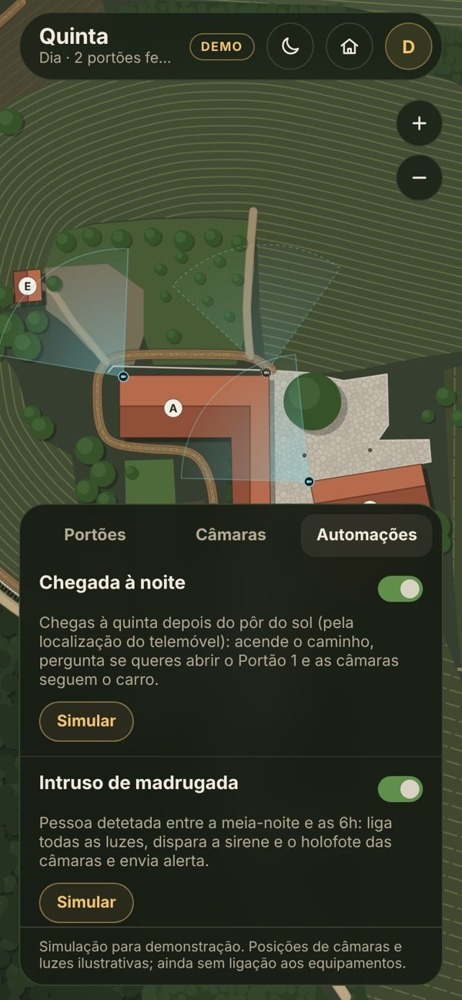

# Quinta · Smart Home Dashboard

A mobile-first web app that puts a property's **gates, cameras and lights on a single interactive 2D map**. It brings devices from different brands into one interface to monitor and control them.

**▶ Live demo:** https://1251102joao.github.io/smart-home-dashboard/
*(runs on simulated data, create a local demo account to try it; best viewed on a phone)*

<p align="center">
  
  &nbsp;&nbsp;
  
</p>

## Features

- **Interactive 2D map** of the property: pan and zoom, tap a gate to inspect it.
- **Camera coverage cones** drawn from each camera's field of view, which makes **blind spots** easy to spot when placing cameras.
- **Gates, lights and sirens** controlled from the map.
- **Automation rules** with a *Simulate* button to preview each one:
  - *Arrival at night*: lights the path, offers to open the gate, cameras follow the car.
  - *Night intruder*: person detected between midnight and 6 am turns on all lights, triggers the siren and camera spotlight, and sends an alert.
  - *Auto-close* and *leaving home* rules.
- **Users and access**: admin account that grants access to other people, PIN and Face ID quick login.
- **Installable PWA** (Add to Home Screen) that also opens offline thanks to a service worker.
- **Day / night mode**.

## Privacy and project status

This is a personal project that I run and test on my own property. The code in this repository is the **public demo**:

- Real device integrations (Tapo, Tuya, V380 Pro and other brands) are in a private testing phase and are **not part of the public version, for privacy reasons**. The demo uses simulated devices and illustrative camera and light positions.
- No credentials, addresses or tokens are stored in the code. The optional [Home Assistant](https://www.home-assistant.io/) bridge connects to an instance that the user provides at runtime.
- Demo accounts are stored only in the browser (`localStorage`) on the device being used.

## Tech

Plain **HTML, CSS and JavaScript** in a single page, with no build step and no framework.

- Layered **SVG** map (base layer + live layer) and **Canvas 2D** for the simulated camera view
- [hls.js](https://github.com/video-dev/hls.js) for live camera streams
- Web App Manifest and service worker (PWA)
- GitHub Pages hosting

The interface is in European Portuguese.

## Run locally

```bash
git clone https://github.com/1251102joao/smart-home-dashboard.git
cd smart-home-dashboard
python3 -m http.server 8000
# open http://localhost:8000 in your browser
```

## Author

**João Pimentel**, Systems Engineering student at ISEP (Porto).
